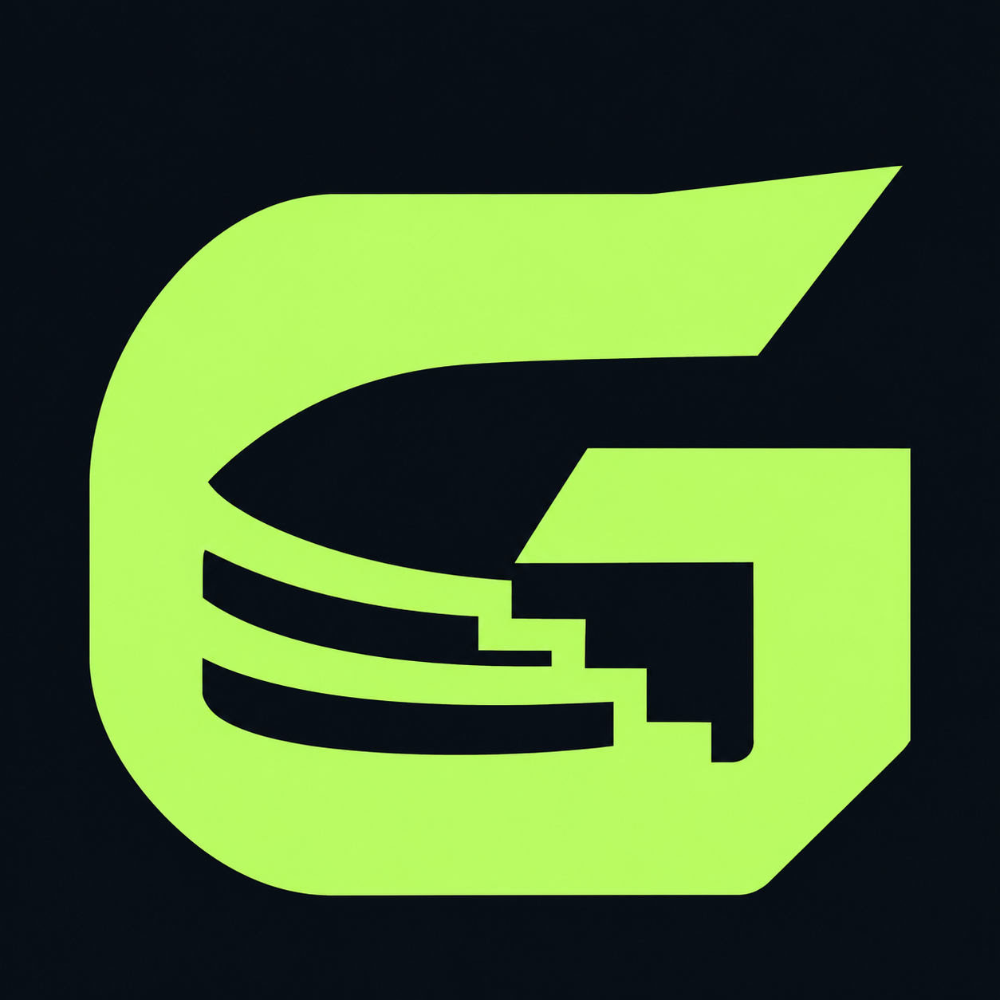

<p align="center"></p>

# Grandstand for Home Assistant

**Your sports dashboard, assembled automatically.**

[☕ **Buy me a coffee · PayPal**](https://paypal.me/maikeltimo) — Support independent development. Every feature stays free.

Previously Sports Hub. Existing installations update in place; personal dashboards and favorites are retained.

Install one integration, choose your competitions, and open **Grandstand** in the Home Assistant sidebar. My Matchday, the sports calendar, live scores, schedule, results, favorites, and league directory are generated for you.


## What you get

- **60 curated competitions across 10 sports**, all preselected during setup.
- Whole scoreboards, including parallel matches, tennis doubles, UFC undercards, and individual motorsport sessions.
- A responsive dashboard for desktop, tablets, and phones, in English, German, Spanish, French, Italian, or Dutch according to your HA language (English fallback).
- Sport, league, date, and text filters; expandable event details and source links.
- **My Matchday** brings followed teams/leagues, current games, next fixtures, recent results and news together.
- **Personal sports calendar** with a month view and up to 90 days of published upcoming fixtures, including F1 sessions.
- Favorites, spoiler protection, default start page and F1 grid appearance sync through your HA user account across devices.
- Optional pre-start reminders on your own HA Companion App device, with lead time and quiet hours.
- **Approved personal dashboards** for teams, athletes, and leagues, with logos and editable colors.
- Optional independent HA sidebar dashboards, published explicitly by an administrator.
- Full-season club schedules, league tables, cup fixtures, recent form, season statistics, squad and venue details.
- Club and league news with publisher, publication time and links to the original articles.
- **Match center** with key events/play-by-play, published starting lineups and substitutes, team-stat comparisons and player box scores.
- **Formula 1 hub** with race weekend, championship, calendar, results and news; optional F1 Sensor live timing, Race Control, weather, documents, tyre strategy and Circle of Doom, including lapped traffic recovered from numeric intervals.
- **Automatic F1 weekend rollover:** overview, upcoming grid, live modules and radar share the next unfinished Grand Prix. A confirmed race finish advances immediately; qualifying and sprint finishes do not. Old live data stays hidden until the new weekend is available. A suspended race remains selected while its live status is fresh. Without a finish signal, the scheduled race window expires after four hours (24 hours when the start time is unconfirmed).
- **F1 results archive:** race results first, qualifying below, with season/year and Grand Prix dropdowns. Available public classifications back to 1950; missing historical qualifying data is shown as unavailable. Changing archive filters does not change the live weekend.
- **Location-specific F1 forecasts** from Open-Meteo for the scheduled race hour when it is within forecast range; Windy radar follows the same circuit.
- **Spoiler protection** for scores, records, winners, standings, form, news and analysis, with per-event score reveal.
- HA timezone-aware dates, including overnight US games and daylight-saving transitions.
- Four compact sensors for automations: live events, scheduled events, competitions, and source errors.
- Automatic recovery, request caching, bounded concurrency, and explicit unavailable/stale data states.

**No API key, Team Tracker installation, or F1TV subscription is required.** This integration displays public sports data, not video streams.

## Installation

Requires **Home Assistant 2026.11.0 or newer**.

### Marketplace / HACS custom repository

1. Open Marketplace and choose **Add via link** (German: **Über Link hinzufügen**). In HACS, use **Custom repositories** instead.
2. Add `https://github.com/maikelfuhrmann/ha-grandstand`. Marketplace detects the integration automatically; in HACS, choose category **Integration**.
3. Download **Grandstand** and restart Home Assistant.
4. Go to **Settings → Devices & services → Add integration → Grandstand**.
5. Keep all competitions or choose a subset, then submit.
6. Open **Grandstand** in the sidebar. No dashboard YAML or frontend resource registration is needed.

This is a custom repository; inclusion in the default marketplace catalog is not implied.

### Manual installation

Download the `ha-sports-hub-0.6.0.zip` release asset and extract it into your HA configuration directory. The resulting path must be:

```text
config/custom_components/sports_hub/manifest.json
```

Restart HA and add the integration as above. All frontend assets are bundled inside the integration.

## Automatic dashboard

The integration registers its own **Grandstand** panel at `/sports-hub`. The complete layout is managed by the integration and populated from the selected competitions. Change the competition selection or date window through the integration's options; the panel updates when the integration reloads.

The first pass loads the neighboring match days; the remaining schedule fills in on the next refresh. Large selections can take a few minutes initially. A loading indicator distinguishes an unfinished schedule from a day with no fixtures.

The default window covers **2 previous days and 7 upcoming days**. It can be changed to 1–7 previous days and 1–14 upcoming days. The overview filters use this loaded window. My Matchday and the personal calendar fetch a separate, longer schedule for your favorites.

Personal and shared dashboards fetch additional season information independently of that short overview window. A Bundesliga league dossier can therefore include all 306 published season matches, while the main hub stays fast. Search discovery still uses the overview data.

## My Matchday, calendar and reminders

**My Matchday** is the default start page. It gathers your favorites into one view with a next/live spotlight, today’s events, upcoming fixtures, recent results, profile shortcuts and up to six linked news headlines. Each event section initially shows 12 cards in chronological order (newest first for results), with a visible shown/total count and **Show more** to reach every loaded event. Expanding one section leaves the others unchanged and survives automatic refreshes. Spoiler protection hides news as well as scores. Change the default to **Overview** in **My settings** if preferred.

Use the star on an existing card under **Dashboards** to include that club or league in My Matchday and the calendar, even during a fixture break. Approved and followed profiles also remain searchable when they have no match in the short overview window. Favorites and settings follow the authenticated HA account across devices. On the first upgrade, that account imports favorites from the first browser that opens Grandstand. If that browser has no previous preferences, the account’s own approved dashboards provide initial favorites. Existing server preferences always win on later devices. Concurrent additions/removals merge individually; settings updates change only the edited fields.

**Sports calendar** shows a monthly view and the selected day’s events, using HA’s timezone. Published schedules cover the last seven and next 90 days where the source has announced them. Soccer favorites include league, cup and international fixtures; Formula 1 includes available practice, qualifying, sprint and race times. The first 40 recognized favorite profiles receive extended schedule requests; all favorites remain eligible for the shared scoreboard. Coverage and stale-source notices are visible. This is not a guarantee of a complete future schedule, and calendar-only historical F1 sessions do not invent results.

In **My settings → Reminders**, select one of your own registered **HA Companion App** devices and enable notifications. Choose 5, 10, 15, 30 or 60 minutes before start and optional quiet hours in HA’s timezone. Reminders contain the event name and a link to Grandstand, never results or news. Only confirmed, scheduled events with sufficiently fresh source data qualify. Grandstand checks every 30 seconds; upstream caching and delivery availability can cause delays or missed alerts. Quiet-time and missed alerts are not replayed. A durable delivery marker prevents duplicates after a restart; failed deliveries are deliberately not retried. No notifications are enabled by upgrading, and other users’ devices cannot be selected.

The calendar inside Grandstand is personal. An administrator may explicitly enable **Publish my sports calendar to Home Assistant**, creating a native calendar entity for HA calendar cards and automations. **That entity is visible to other HA users**; the settings screen explains this before saving. Turn the option off to clear its events and mark it unavailable. Unconfirmed times appear as all-day entries; end times are estimated viewing blocks rather than actual final-whistle times. No shared calendar is created by default.

## Personal team and league dashboards

Search for a team (for example, **FC Bayern**) or mark a team/league as a favorite. Grandstand prepares a preview with its logo and available provider colors. Review the name and colors, then select **Approve dashboard**. Choosing **Later** keeps the favorite without creating a dashboard. Pending suggestions are available under **Dashboards**.

Approved dashboards live under **Grandstand → Dashboards**, are stored on the HA server for your signed-in user, and follow you across browsers/devices. They load a richer dossier on demand: published season fixtures and results across competitions, full standings, form from the last five matches, league/cup progress, season totals and home/away splits, squad, home venue, and news. Availability varies by sport and provider. Existing approved dashboards automatically receive the richer layout after updating; no new approval is needed.

When club metadata omits the home stadium, Grandstand uses the latest played regular league home fixture, or the next scheduled one before any have been played. Friendlies, cup ties, away games, neutral venues and unknown neutral-site flags cannot supply this fallback. The event weather radar independently follows the actual match venue.

Administrators can also check **Also show in the Home Assistant sidebar** before approval. This creates a separate, automatically managed Grandstand panel with its own URL and sidebar entry. **Shared sidebar dashboards are visible to all HA users**; the approval dialog explains this. They are custom panels, not editable Lovelace/YAML dashboards. Removing a personal dashboard leaves a published sidebar panel intact; administrators can remove that separately under **Dashboards**.

Logos and team colors come from the provider when available; supported league palettes have curated defaults. Missing metadata uses a neutral fallback and all colors remain editable. Team and competition names follow the data source. The interface, dates, setup forms, and sensor names support **English, German, Spanish, French, Italian, and Dutch**. Additional languages can be added in `frontend/i18n.js` and `translations/`.

## Match center

Open **Details** on a team-sport match to see its Overview, Timeline, Lineups, Match Statistics and Player Statistics. Soccer displays the published starting XI on a football pitch in club colors, with goalkeeper, formation, player names and shirt numbers. Both teams attack upward in this schematic; these are not live player coordinates. The substitutes remain below the pitch, and the starting XI is also available as a text list. If the source does not supply a complete XI, a valid formation and supported player roles, the published list remains available without guessed positions. Goals, cards, substitutions and other key events appear in the timeline. Supported ESPN team-sport summaries also expose basketball/hockey play-by-play, NFL drive events and sport-specific player box scores when available. Tennis, MMA and leaderboard sports retain their event details rather than borrowing a different contest's summary.

The open view checks for updates every 30 seconds, with 30-second server caching for live/near-start matches and 15-minute caching otherwise. It preserves the selected tab and scroll position. Spoiler protection covers the entire match center until the user reveals that match. A failed refresh retains cached facts with a stale label.

Only structured event facts are assembled into the timeline; article bodies, editorial commentary and betting odds are not republished. The source's coverage can be partial, and the latest 200 available events are displayed newest-first. Before kickoff, lineups can be unpublished; any provider season totals are clearly labelled as a **pre-match season comparison**, never live match statistics. Detailed statistical labels without a local translation retain the source's label.

## Formula 1

Approve **Formula 1** as a league dashboard to get dedicated Overview, Live, Championship, Schedule, Results, Race Control, Strategy and News tabs.

- **Without additional integrations:** [Jolpica](https://api.jolpi.ca/ergast/) supplies the published season calendar, session times, driver/constructor standings and archived race classifications. News comes through the same localized news adapter as other dossiers.
- **With [F1 Sensor](https://nicxe.github.io/f1_sensor/) installed:** Grandstand discovers the loaded entry and uses its bundled modular cards. Enable F1 Sensor's dashboard cards in its options. No entry IDs or entity names need to be copied manually. If several F1 Sensor entries are loaded, the first loaded entry is used.
- Dedicated **Qualifying** and **Starting grid** tabs show the selected race weekend. Qualifying includes Q1/Q2/Q3, the top three and the separate published grid position. Official Formula1.com result tables supplement Jolpica when its segment times are missing. Published starting grids take precedence over provisional qualifying order; the source, update time, penalty notes and position changes remain visible. After the main race ends these tabs follow the next weekend; past classifications stay in Results, with independent season and race selectors.
- The **staggered starting grid** offers a **Portrait / Full body / Cars** switch. Portrait is the default: a matching official headshot from the optional F1 Sensor Driver list entity, or a close crop of the official 2026 driver photo. Full body and team car images are available from Formula1.com. Missing portraits use a neutral silhouette; missing car images use a schematic car. The view preference syncs through your HA user account. Enable **Driver list (live)** in F1 Sensor to expose its optional headshot URLs. Images require a matching person and season. Images are matched by driver name and season, never just by number. Unknown teams and other seasons never borrow the wrong livery. These are team publicity images, not live camera views or a guarantee of race-specific liveries. Image rights remain with Formula 1 and the respective owners; assets are remotely loaded and not included in this repository's MIT license.
- Public qualifying/grid results work without F1TV or F1 Sensor. When F1 Sensor is installed, its protected starting-grid channel remains available and its spoiler blocking is respected. Grandstand's spoiler toggle hides both views. Pit-lane starts and unknown positions stay separate; pole side and spacing are schematic.
- The live views include timing, weather, Race Control, tyres, FIA documents and investigations. Live modules are only mounted when their session belongs to the selected weekend. The live track-map panel is omitted from this public-timing dashboard. The Live tab places **Circle of Doom** below the race status and above live timing, and the Strategy tab also embeds it when the driver-position entity is available. Existing F1 Sensor and Circle of Doom installations are reused. Circle of Doom intentionally retains its English interface.
- Public timing does not require F1TV. **Live car positions, team radio and detailed pit-stop data are not guaranteed without the additional authorized access required by F1 Sensor.** Grandstand does not provide or bypass that access. No synthetic car positions or race-control messages are generated.
- Live modules reflect F1 Sensor's session/availability state. No active session means no new live telemetry. The overview, race forecast and results archive work independently; championship and schedule also retain an expandable Jolpica fallback.
- An existing dashboard at `dashboard-f1` is linked directly. Household-specific lights and automations are not copied into the public integration.

## Rich data sources and freshness

Detailed dossiers load when an **approved** dashboard is opened. The personal landing page and calendar can also fetch schedules and headlines for favorites without requiring a separate approved dashboard. ESPN team schedules cover the provider's published season; soccer uses the all-competitions team schedule, so cup and international fixtures are included when published. League schedules use the provider's season boundaries, including New Year, and bounded monthly requests. Unsigned future rounds, opponents and kickoff times remain unknown; cup progression is shown as published rounds/fixtures, not an invented tournament bracket.

Standings retain conference/group structure. Some competitions or sports have no comparable team table, squad or venue data. Those sections explicitly show that data is unavailable. Team names, round descriptions and roster metadata retain the provider's language. Six-language interface labels do not translate third-party articles or official Race Control messages.

News uses Google News RSS search for the selected club/league in the HA interface language, with an ESPN fallback. Only headlines, publisher, timestamp and article links are displayed, never republished article bodies. News relevance, access restrictions and original language depend on the publisher. ESPN fallback articles may be older; publication dates are always displayed.

Additional requests share a cache and four-request concurrency limit. Typical cache intervals: results/standings/news 15 minutes; team fixtures 30 minutes; club metadata and F1 season data one hour; squads and distant league months six hours. Current-month league schedules use 15 minutes. Live score updates still come from the main scoreboard polling. Sources and retrieval times appear at the bottom of each dossier; cached data remains visible and is labelled stale when refresh fails.

## Coverage

The [competition catalog](docs/competitions.md) includes Bundesliga and 2. Bundesliga, Premier League, LaLiga, Serie A, Ligue 1, European cups, international tournaments, women's competitions, MLS, NFL, NBA/WNBA, NHL, MLB, NCAA, ATP/WTA, UFC, PGA/LPGA/DP World/LIV, F1, IndyCar, NASCAR, NBL, and AFL.

All 60 scoreboard endpoints were checked successfully on **8 November 2026**; see the [verification report](docs/coverage-check.json). An empty response means that the provider returned no fixtures for that query. It does not establish complete coverage of a season.

Coverage depends on ESPN's public scoreboards. These endpoints have no availability guarantee and can change. Competitions without a working data source, including MotoGP, WEC, DTM, DEL and the German handball Bundesliga, are **not included in this release**. The catalog is intentionally explicit rather than claiming every league worldwide.

## Data and privacy

Scores are fetched by your HA server over HTTPS. Live and near-start events are checked about every 30 seconds; idle nearby dates every 15 minutes; more distant dates every 6 hours. Failed requests use exponential backoff. Actual update timing depends on the upstream source and network conditions.

Scores remain cached during failures and receive a stale-data label. A score older than two minutes is not shown as live. Delayed, suspended, postponed and cancelled events are not reported as live either. Missing scores stay blank instead of becoming `0:0`.

Full scoreboards are kept in memory and sent to the authenticated dashboard over HA's WebSocket connection. They are not written as large recorder attributes. Favorites and personal settings are stored per authenticated HA user on the server. Local browser storage is a startup cache and first-upgrade migration source; a second device cannot overwrite the existing account with its older favorites. Approved dashboard definitions are stored separately in HA and scoped to the authenticated user; sidebar definitions are shared after administrator approval. Team logos and player headshots are loaded from provider URLs by the browser. Opening a dossier or My Matchday sends the followed club/league name and selected news language to Google News or ESPN from the HA server; it does not send HA user IDs, credentials or dashboard settings. F1 season and archive requests go to Jolpica. Race-hour forecast requests send only the public circuit coordinates to Open-Meteo, with attribution shown in the weather card. Opening an article connects your browser to the publisher or Google News. There is no analytics added by this project.

ESPN and competition/team names and logos belong to their respective owners. Grandstand is an independent community project, not affiliated with ESPN or any sports league.

## Development

```sh
python3.14 -m venv .venv
.venv/bin/pip install homeassistant==2026.11.0
.venv/bin/python -m unittest discover -s tests -v
npm run check
.venv/bin/python scripts/smoke_ha.py
.venv/bin/python scripts/package.py
```

The smoke test boots an isolated, real HA runtime, mocks only the upstream sports data, and checks configuration, automatic panel registration, sensors, approved dashboard persistence, shared sidebar registration, native-calendar opt-in/revocation, unload, and reload. It does not connect to a user's HA instance.

For an offline UI preview, serve this repository using `python3 -m http.server 8767 --bind 127.0.0.1` and open `http://127.0.0.1:8767/docs/preview.html`. The bundled demo is clearly labelled and uses synthetic teams/results.

## Support

If Grandstand is useful to you, you can [support development via PayPal](https://paypal.me/maikeltimo).

MIT licensed. The bundled `frontend/vendor/f1-circle-of-doom-card.js` is version 0.3.1 from [ha-f1-circle-of-doom-card](https://github.com/maikelfuhrmann/ha-f1-circle-of-doom-card), also MIT licensed; its license is included alongside the file. F1 Sensor cards are loaded from the user’s installed integration and are not redistributed. Issues and pull requests are welcome.

### Venue radar sources

Radar is embedded from [Windy](https://embed.windy.com/config/map), retaining its controls, timestamps and attribution. Coverage depends on Windy and the local radar network. No F1TV subscription or personal weather API key is required.

Circuit coordinates come from Jolpica; other event venues use supplied ESPN coordinates when available. Otherwise the opened event triggers one cached [Photon](https://github.com/komoot/photon) lookup of its venue name and country. Only exact venue-name matches of sports facilities are accepted; stations, ambiguous matches and missing locations do not become guessed map centers. Photon coordinates are © OpenStreetMap contributors, ODbL. Queries are cached for seven days and are never run for every fixture in a season. The public service offers no availability guarantee; deployments with substantial traffic should replace the endpoint in `venue.py` with their own Photon instance. Home Assistant home coordinates are never used.
