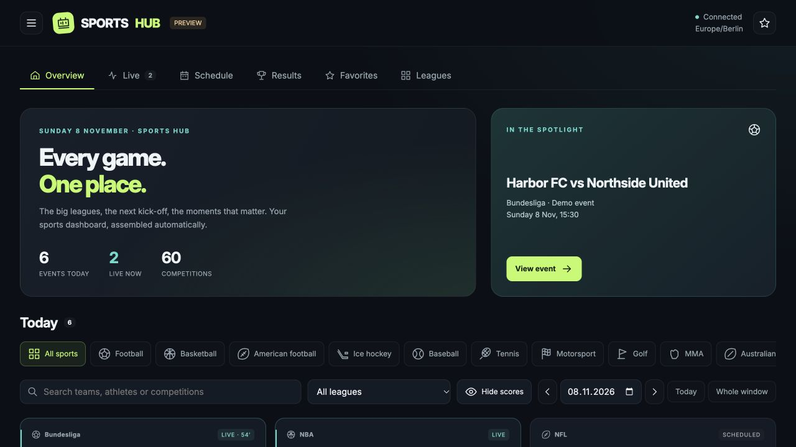

# Sports Hub for Home Assistant

**Your sports dashboard, assembled automatically.**

Install one integration, choose your competitions, and open **Sports Hub** in the Home Assistant sidebar. The overview, live scores, schedule, results, favorites, and league directory are generated for you.



## What you get

- **60 curated competitions across 10 sports**, all preselected during setup.
- Whole scoreboards, including parallel matches, tennis doubles, UFC undercards, and individual motorsport sessions.
- A responsive dashboard for desktop, tablets, and phones, in English, German, Spanish, French, Italian, or Dutch according to your HA language (English fallback).
- Sport, league, date, and text filters; expandable event details and source links.
- Favorite teams and athletes across competitions. Preferences are stored per HA user on the current browser/device.
- **Approved personal dashboards** for teams, athletes, and leagues, with logos and editable colors.
- Optional independent HA sidebar dashboards, published explicitly by an administrator.
- **Spoiler protection** for scores, records, winners and leaderboard order, with per-event reveal.
- HA timezone-aware dates, including overnight US games and daylight-saving transitions.
- Four compact sensors for automations: live events, scheduled events, competitions, and source errors.
- Automatic recovery, request caching, bounded concurrency, and explicit unavailable/stale data states.

**No API key, Team Tracker installation, or F1TV subscription is required.** This integration displays public sports data, not video streams.

## Installation

Requires **Home Assistant 2026.11.0 or newer**.

### Marketplace / HACS custom repository

1. Open Marketplace and choose **Add via link** (German: **Über Link hinzufügen**). In HACS, use **Custom repositories** instead.
2. Add `https://github.com/maikelfuhrmann/ha-sports-hub`. Marketplace detects the integration automatically; in HACS, choose category **Integration**.
3. Download **Sports Hub** and restart Home Assistant.
4. Go to **Settings → Devices & services → Add integration → Sports Hub**.
5. Keep all competitions or choose a subset, then submit.
6. Open **Sports Hub** in the sidebar. No dashboard YAML or frontend resource registration is needed.

This is a custom repository; inclusion in the default marketplace catalog is not implied.

### Manual installation

Download the `ha-sports-hub-0.2.0.zip` release asset and extract it into your HA configuration directory. The resulting path must be:

```text
config/custom_components/sports_hub/manifest.json
```

Restart HA and add the integration as above. All frontend assets are bundled inside the integration.

## Automatic dashboard

The integration registers its own **Sports Hub** panel at `/sports-hub`. The complete layout is managed by the integration and populated from the selected competitions. Change the competition selection or date window through the integration's options; the panel updates when the integration reloads.

The first pass loads the neighboring match days; the remaining schedule fills in on the next refresh. Large selections can take a few minutes initially. A loading indicator distinguishes an unfinished schedule from a day with no fixtures.

The default window covers **2 previous days and 7 upcoming days**. It can be changed to 1–7 previous days and 1–14 upcoming days. Search and favorites operate within this loaded window.

If an existing Formula 1 dashboard is present at `dashboard-f1`, F1 event details offer a shortcut to it.

## Personal team and league dashboards

Search for a team (for example, **FC Bayern**) or mark a team/league as a favorite. Sports Hub prepares a preview with its logo and available provider colors. Review the name and colors, then select **Approve dashboard**. Choosing **Later** keeps the favorite without creating a dashboard. Pending suggestions are available under **Dashboards**.

Approved dashboards live under **Sports Hub → Dashboards**, are stored on the HA server for your signed-in user, and follow you across browsers/devices. They include an overview, live events, schedule, and results across the loaded competitions. The preview does not imply a complete season archive or standings.

Administrators can also check **Also show in the Home Assistant sidebar** before approval. This creates a separate, automatically managed Sports Hub panel with its own URL and sidebar entry. **Shared sidebar dashboards are visible to all HA users**; the approval dialog explains this. They are custom panels, not editable Lovelace/YAML dashboards. Removing a personal dashboard leaves a published sidebar panel intact; administrators can remove that separately under **Dashboards**.

Logos and team colors come from the provider when available; supported league palettes have curated defaults. Missing metadata uses a neutral fallback and all colors remain editable. Team and competition names follow the data source. The interface, dates, setup forms, and sensor names support **English, German, Spanish, French, Italian, and Dutch**. Additional languages can be added in `frontend/i18n.js` and `translations/`.

## Coverage

The [competition catalog](docs/competitions.md) includes Bundesliga and 2. Bundesliga, Premier League, LaLiga, Serie A, Ligue 1, European cups, international tournaments, women's competitions, MLS, NFL, NBA/WNBA, NHL, MLB, NCAA, ATP/WTA, UFC, PGA/LPGA/DP World/LIV, F1, IndyCar, NASCAR, NBL, and AFL.

All 60 scoreboard endpoints were checked successfully on **8 November 2026**; see the [verification report](docs/coverage-check.json). An empty response means that the provider returned no fixtures for that query. It does not establish complete coverage of a season.

Coverage depends on ESPN's public scoreboards. These endpoints have no availability guarantee and can change. Competitions without a working data source, including MotoGP, WEC, DTM, DEL and the German handball Bundesliga, are **not included in this release**. The catalog is intentionally explicit rather than claiming every league worldwide.

## Data and privacy

Scores are fetched by your HA server over HTTPS. Live and near-start events are checked about every 30 seconds; idle nearby dates every 15 minutes; more distant dates every 6 hours. Failed requests use exponential backoff. Actual update timing depends on the upstream source and network conditions.

Scores remain cached during failures and receive a stale-data label. A score older than two minutes is not shown as live. Delayed, suspended, postponed and cancelled events are not reported as live either. Missing scores stay blank instead of becoming `0:0`.

Full scoreboards are kept in memory and sent to the authenticated dashboard over HA's WebSocket connection. They are not written as large recorder attributes. Favorite and spoiler settings use local browser storage; they do not currently sync across devices. Approved dashboard definitions are stored separately in HA and scoped to the authenticated user; sidebar definitions are shared after administrator approval. Team logos are loaded from provider URLs by the browser. There is no analytics or tracking added by this project.

ESPN and competition/team names and logos belong to their respective owners. Sports Hub is an independent community project, not affiliated with ESPN or any sports league.

## Development

```sh
python3.14 -m venv .venv
.venv/bin/pip install homeassistant==2026.11.0
.venv/bin/python -m unittest discover -s tests -v
npm run check
.venv/bin/python scripts/smoke_ha.py
.venv/bin/python scripts/package.py
```

The smoke test boots an isolated, real HA runtime, mocks only the upstream sports data, and checks configuration, automatic panel registration, sensors, approved dashboard persistence, shared sidebar registration, unload, and reload. It does not connect to a user's HA instance.

For an offline UI preview, serve this repository using `python3 -m http.server 8767 --bind 127.0.0.1` and open `http://127.0.0.1:8767/docs/preview.html`. The bundled demo is clearly labelled and uses synthetic teams/results.

## Support

If Sports Hub is useful to you, you can [support development via PayPal](https://paypal.me/maikeltimo).

MIT licensed. Issues and pull requests are welcome.
